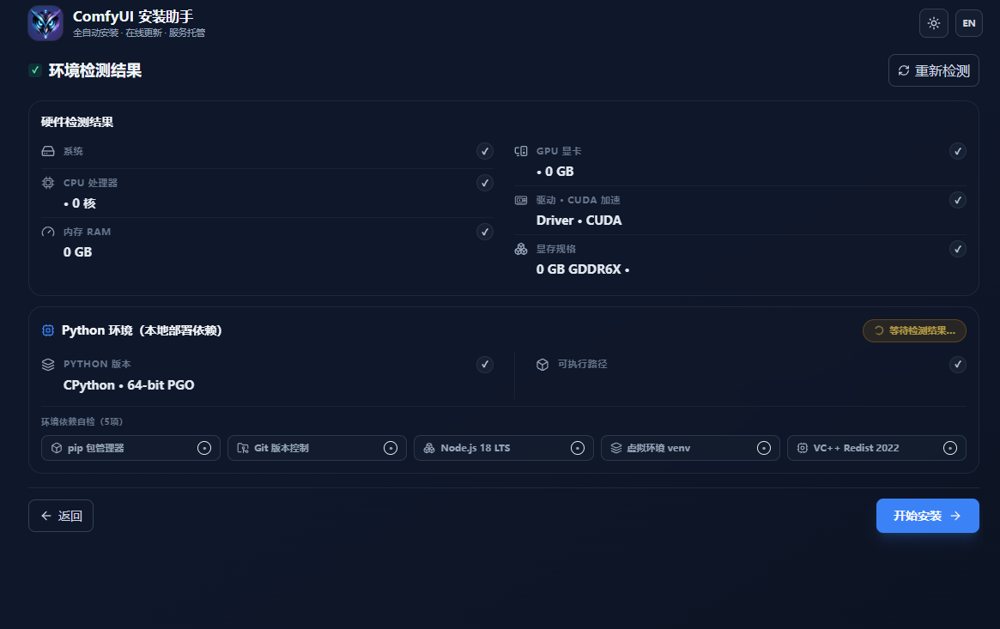
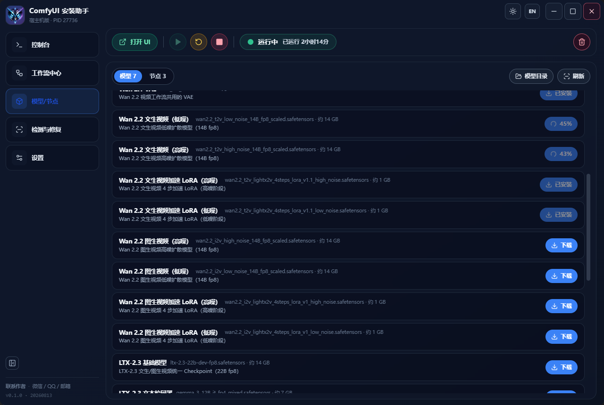

[English](README.md) | [简体中文](README.zh-CN.md) | [Personal Website](https://zhinian-ai.com)

# ComfyUI Windows Installer

A Windows UI for ComfyUI setup and maintenance.

## Screenshots




## Features
- Environment detection
- Python and PyTorch installation
- Model and node configuration
- Repair and version management

## Development
```bash
npm install
npm run dev
```

## License
MIT License; retain LICENSE and NOTICE. Third-party components remain under their own licenses.

---

## Personal Website

**ZHIRAI / 智睿科技** — [zhinian-ai.com](https://zhinian-ai.com)
