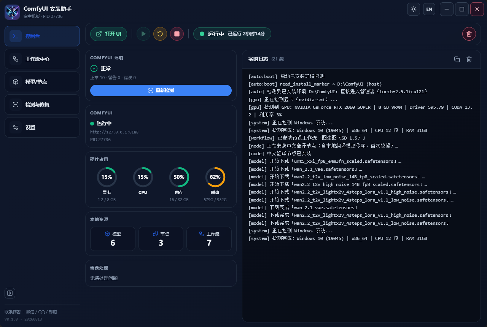
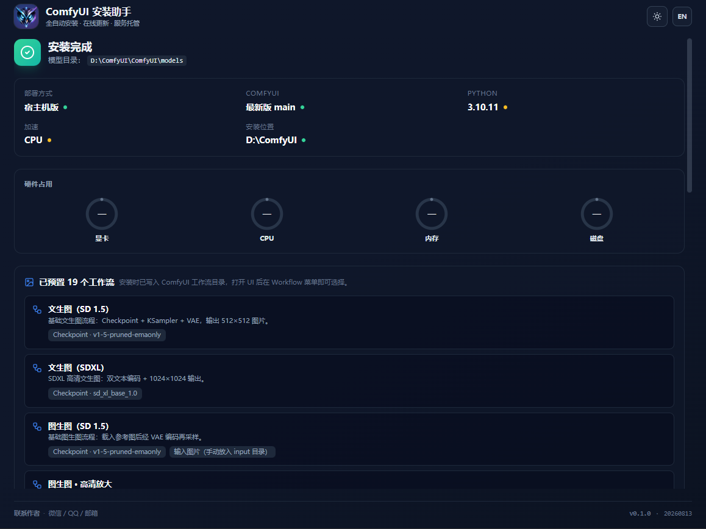
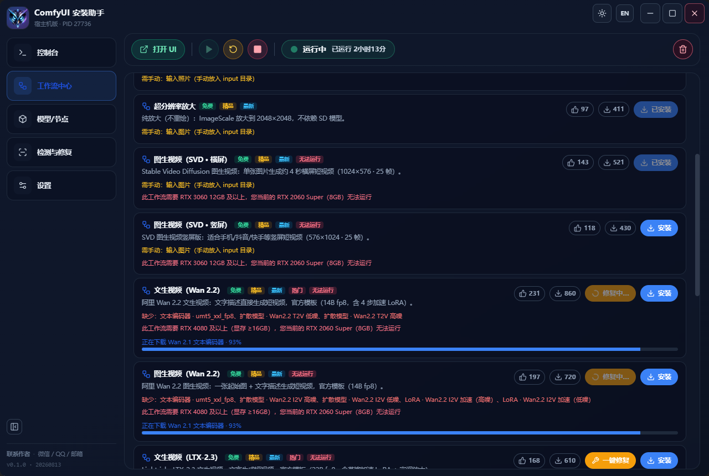
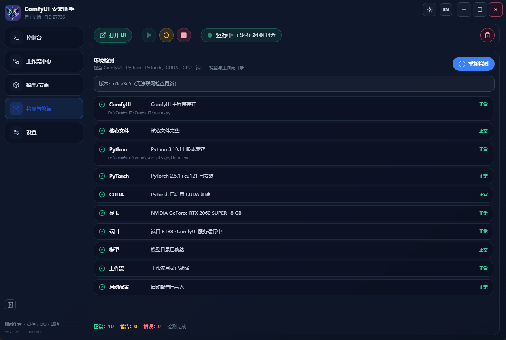

# ComfyUI 安装助手

> 全自动安装 · 智能硬件识别 · 在线更新 · 服务托管

[English](README.md)

**ComfyUI 安装助手**是一款面向普通用户的 ComfyUI 桌面客户端。它把「下载 Python、配置虚拟环境、按显卡选 PyTorch、安装依赖、编写启动脚本」这套复杂流程，压缩成**点几下鼠标**就能完成的一键安装。全程中文界面 + 实时日志，小白也能看懂每一步在干什么。

---

## 目录

- [它解决了什么问题](#它解决了什么问题)
- [核心功能](#核心功能)
- [两种部署方式](#两种部署方式)
- [系统要求](#系统要求)
- [显卡能力档位](#显卡能力档位)
- [快速上手](#快速上手)
- [工作流市场](#工作流市场)
- [模型与节点管理](#模型与节点管理)
- [常见问题（FAQ）](#常见问题faq)
- [下载安装](#下载安装)
- [版本历史](#版本历史)
- [后续规划](#后续规划)
- [联系作者](#联系作者)

---

## 它解决了什么问题

ComfyUI 本身非常强大，但安装门槛劝退了大量新手：

- 要先装 **Python**（版本还不能错）；
- 要创建**虚拟环境**；
- 要按显卡型号挑选 **PyTorch / CUDA** 版本；
- 要安装几十上百个**依赖包**；
- 要自己写**启动脚本**、配端口和启动参数。

任何一步出错，迎接你的就是满屏英文报错。

**ComfyUI 安装助手把这些步骤全部自动化**，你只需要：

1. 打开软件；
2. 选择「本地部署」或「容器版」；
3. 点「开始安装」。

剩下的交给软件，装完自动启动并打开界面。

---

## 核心功能

### 1. 一键全自动安装
- 自动准备 Python 环境（无系统 Python 时自动下载便携版 Python 3.10）；
- 自动下载 ComfyUI（默认最新版，也可指定分支 / 标签）；
- 自动创建虚拟环境、安装依赖、配置启动器；
- 安装完成自动启动服务并打开 Web UI。

### 2. 智能硬件识别
- 自动检测显卡型号、显存、驱动版本、CPU、内存、磁盘；
- 内置显卡数据库，自动规范化型号（如 `NVIDIA GeForce RTX 2060` → `RTX 2060`）；
- 显存优先读取 nvidia-smi 实测值，保证判断准确。

### 3. 显卡能力评估
根据当前显存自动划分档位，并给出对应能跑的内容：

| 档位 | 显存 | 能做什么 |
|------|------|----------|
| 入门级 | < 6 GB | SD 1.5 / SDXL 低分辨率图片；小模型、低分辨率视频 |
| 中端 | 6~11 GB | SD / SDXL Turbo 2K 图片；AnimateDiff / SVD 720P 短视频 |
| 高端 | 12~19 GB | SDXL + FLUX.1 图片；CogVideoX 5B / Wan2.1 7B 短视频；全身数字人 |
| 旗舰级 | ≥ 20 GB | 8K 超分；Wan2.1 / HunyuanVideo 1080P 长视频；多角色直播级数字人；4K 3D |

### 4. 工作流市场
- 内置「免费 / 精品 / 最新 / 热门」分类；
- 一键安装工作流，自动补全缺失的模型；
- 无法运行的工作流会明确提示：「此工作流需要 XX 及以上，您当前的 XX（XGB）无法运行」，小白也能看懂要升级什么。

### 5. 模型 / 节点管理
- 常用模型一键下载，自动安装到模型目录；
- 自定义节点一键安装、删除；
- 支持安装中文翻译节点。

### 6. 中文提示词自动翻译
- 提示词框可直接输入中文，本地翻译模型自动翻译成英文；
- 全程本地运行，无需联网（首次运行下载约 300MB 翻译模型）。

### 7. 环境检测与一键修复
- 一键检测 ComfyUI、Python、PyTorch、CUDA、GPU、端口、模型与工作流目录；
- 发现问题可一键修复，不用从头重装。

### 8. 体验优化
- 系统托盘后台运行，支持单实例；
- 中英文界面切换、亮 / 暗主题；
- 客户端在线更新（半自动，检测到新版本手动点下载安装）。

---

## 两种部署方式

| | 本地部署（宿主机版） | 容器版部署（Docker） |
|---|---|---|
| 适合人群 | 普通用户 | 技术用户 |
| 优点 | GPU 直通最稳、显存占用最低、启动最快 | 版本随时回滚、环境可迁移、多套隔离 |
| 缺点 | 跨机迁移需重装 | 需先装 Docker Desktop（约 2GB）；显存额外 +1~2GB |
| 前置要求 | 无（自动装便携 Python） | 开启 WSL2 + 安装 Docker Desktop |

> 首次使用建议选「本地部署」，门槛最低、最省显存。

---

## 系统要求

| 项目 | 要求 |
|------|------|
| 操作系统 | Windows 10 / 11 64 位 |
| 显卡 | 推荐 NVIDIA 显卡（支持 CPU 模式，速度较慢） |
| 磁盘 | 剩余 ≥ 30GB（推荐 ≥ 50GB，模型文件较大） |
| 内存 | 本地版 ≥ 8GB；容器版 ≥ 16GB |
| 网络 | 安装过程需联网下载（可配置加速源） |

---

## 快速上手

1. 到 [Releases](https://github.com/tangxiaoqi966-lab/comfyui-installer/releases) 下载最新 Windows 安装包；
2. 双击安装，打开「ComfyUI 安装助手」；
3. 选择「本地部署」或「容器版」，选择安装目录（推荐非系统盘）；
4. 点击「开始安装」，等待自动完成（首次 PyTorch 下载约 5~30 分钟，属正常）；
5. 安装完成后自动启动，点「打开 UI」在浏览器中使用。

---

## 常见问题（FAQ）

**Q：安装过程中卡住了怎么办？**
看实时日志，它会告诉你在哪一步、什么原因。常见原因是网络慢、磁盘空间不足、PyTorch 下载中断。可重试，或到「设置」配置下载加速源。

**Q：怎么知道我的显卡能不能跑某个工作流？**
工作流市场会自动判断。能跑的显示「安装」，不能跑的会明确提示需要的最低显卡档位和显存。

**Q：提示词只能用英文吗？**
不用。提示词框直接写中文即可，本地模型自动翻译成英文。

**Q：软件怎么更新？**
客户端内置更新检测，主页发现新版本时点「下载更新」即可，手动安装，不会静默后台安装。

**Q：数据存在哪里？**
默认安装在非系统盘（如 `D:\ComfyUI`），模型、节点、工作流都在该目录下，卸载会删除整个目录（会二次确认）。

---

## 下载安装

- 最新版本：https://github.com/tangxiaoqi966-lab/comfyui-installer/releases/latest
- 全部版本：https://github.com/tangxiaoqi966-lab/comfyui-installer/releases

> 本仓库仅用于发布编译后的安装包，**不含源代码**。

---

## 版本历史

- **v0.1.0**（2026-08）：首个版本。支持本地 / 容器两种部署、智能硬件识别、工作流市场、模型 / 节点管理、中文提示词翻译、环境检测与一键修复、客户端在线更新。

---

## 后续规划

- 接入真实统计（工作流点赞 / 下载量种子值 + 真实累加）；
- 服务端下发个性化能力评估与推荐；
- 自定义 pip / PyTorch 下载加速源；
- 自定义 ComfyUI 仓库地址；
- 按显存手动选择 PyTorch / CUDA 版本；
- 安装完成后自动下载指定模型清单。

---

## 联系作者

- 微信 / QQ / 邮箱（见软件内「联系作者」）
- 建议反馈与问题请在 [Issues](https://github.com/tangxiaoqi966-lab/comfyui-installer/issues) 提交

---

© 2026 智睿科技（Zhirui Tech）保留所有权利。
